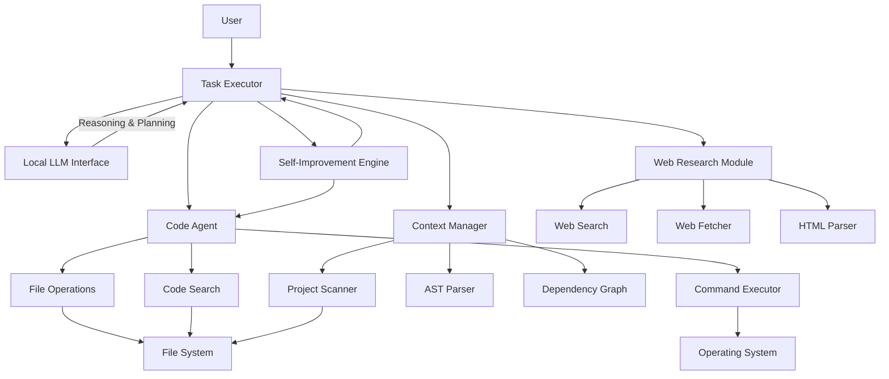

# Design Document: Local AI Development Environment

## Overview

The Local AI Development Environment is an autonomous, locally-executing AI system that writes, edits, and improves code without relying on cloud services. The system follows a plan-execute-observe agent loop pattern, where the AI agent plans actions, executes them through tool interfaces, observes results, and iterates until task completion.

The architecture consists of modular components orchestrated by a central Task Executor that coordinates the agent loop, code manipulation, context management, and web research capabilities. All operations execute locally using a configurable local language model (LLM) as the reasoning engine.

### Key Design Principles

1. **Local-First Architecture**: All core functionality operates without internet connectivity using local resources
2. **Modular Component Design**: Clear separation between reasoning (LLM), execution (tools), and orchestration (task executor)
3. **Tool-Based Agent Interface**: The LLM interacts with the system through a defined set of tools for file operations, code analysis, command execution, and web research
4. **Context-Aware Code Generation**: Code operations are informed by project structure, dependencies, and existing conventions
5. **Autonomous Operation**: The system handles complete development workflows from task description to verified implementation

## Architecture

### System Components

The system is organized into the following major components:



### Component Responsibilities

**Task Executor**
- Orchestrates the agent loop: plan → execute → observe → iterate
- Coordinates all system components to complete development tasks
- Manages task state and execution context
- Provides progress tracking and logging
- Handles error recovery and retry logic

**Local LLM Interface**
- Abstracts communication with the local language model
- Supports multiple local LLM backends (Ollama, llama.cpp, etc.)
- Manages model configuration (temperature, context length, endpoint)
- Handles request/response formatting and error handling
- Provides streaming and non-streaming response modes

**Code Agent**
- Executes code-related operations: create, read, update, delete files
- Generates new code following project conventions
- Edits existing code with precise modifications
- Runs shell commands for building, testing, and development tools
- Performs code search and navigation

**Context Manager**
- Analyzes project structure and technology stack
- Builds and maintains dependency graphs between code components
- Extracts relevant code context for LLM consumption
- Identifies which files and symbols are relevant to a task
- Tracks project changes and updates internal understanding

**Web Research Module**
- Searches the web for relevant documentation and information
- Fetches and extracts content from web pages
- Parses HTML to extract text and code examples
- Prioritizes official documentation sources
- Provides attribution for information sources

**Self-Improvement Engine**
- Analyzes the system's own codebase for improvement opportunities
- Proposes and implements improvements to system capabilities
- Tests improvements before finalization
- Reverts changes that reduce effectiveness
- Maintains audit log of self-modifications

## Components and Interfaces

### Task Executor

The Task Executor implements the core agent loop and orchestrates all system components.

**Interface**:
```python
class TaskExecutor:
    def execute_task(self, task_description: str) -> TaskResult:
        """Execute a complete development task"""
        
    def plan_task(self, task_description: str) -> ExecutionPlan:
        """Break task into steps using LLM"""
        
    def execute_step(self, step: ExecutionStep) -> StepResult:
        """Execute a single step and observe results"""
        
    def should_continue(self, results: List[StepResult]) -> bool:
        """Determine if task is complete or needs more steps"""
```

**Agent Loop Pattern**:
1. **Plan**: LLM receives task description and current context, generates execution plan
2. **Execute**: Execute planned steps using appropriate tools (Code Agent, Context Manager, etc.)
3. **Observe**: Collect results from tool execution (success, errors, output)
4. **Reflect**: LLM analyzes results and decides next action (continue, retry, complete, fail)
5. **Iterate**: Return to Execute if more work needed, otherwise complete

**State Management**:
- Maintains execution history (actions taken, results observed)
- Tracks which files have been modified
- Stores test results and verification status
- Manages context window for LLM (summarizes old steps to fit new context)

### Local LLM Interface

Provides abstraction over different local LLM backends.

**Interface**:
```python
class LocalLLMInterface:
    def __init__(self, config: LLMConfig):
        """Initialize with endpoint, model, and parameters"""
        
    def generate(self, prompt: str, tools: List[Tool]) -> LLMResponse:
        """Generate response with optional tool definitions"""
        
    def stream_generate(self, prompt: str) -> Iterator[str]:
        """Stream response tokens as they're generated"""
        
    def encode(self, text: str) -> List[int]:
        """Tokenize text (for context length calculation)"""
```

**Supported Backends**:
- **Ollama**: REST API on `http://localhost:11434` (recommended for ease of use)
- **llama.cpp Server**: Compatible with OpenAI API format
- **Generic OpenAI-Compatible**: Any server implementing OpenAI's completion API

**Configuration**:
```python
@dataclass
class LLMConfig:
    endpoint: str  # e.g., "http://localhost:11434"
    model_name: str  # e.g., "codellama:13b"
    temperature: float = 0.2
    max_tokens: int = 4096
    context_length: int = 16384
    backend_type: str = "ollama"  # ollama, llamacpp, openai-compatible
```

**Tool Calling Protocol**:
The LLM interface translates between the system's tool definitions and the LLM's function calling format. When the LLM wants to use a tool, it returns structured output that the Task Executor parses and routes to the appropriate component.

### Code Agent

Handles all code-related operations.

**File Operations Interface**:
```python
class FileOperations:
    def create_file(self, path: str, content: str) -> OperationResult:
        """Create a new file with content"""
        
    def read_file(self, path: str) -> str:
        """Read file contents"""
        
    def update_file(self, path: str, content: str) -> OperationResult:
        """Replace entire file content"""
        
    def patch_file(self, path: str, edits: List[Edit]) -> OperationResult:
        """Apply precise edits to specific line ranges"""
        
    def delete_file(self, path: str) -> OperationResult:
        """Delete a file"""
        
    def move_file(self, src: str, dst: str) -> OperationResult:
        """Move or rename file"""
```

**Code Search Interface**:
```python
class CodeSearch:
    def search_text(self, pattern: str, file_pattern: str = "*") -> List[SearchResult]:
        """Search for text pattern (regex) across files"""
        
    def search_files(self, name_pattern: str) -> List[str]:
        """Find files matching name pattern"""
        
    def find_symbol(self, symbol_name: str) -> List[SymbolLocation]:
        """Find function/class definitions"""
```

**Command Execution Interface**:
```python
class CommandExecutor:
    def execute(self, command: str, cwd: str = None, timeout: int = 60) -> CommandResult:
        """Execute shell command and capture output"""
        
    def execute_async(self, command: str, cwd: str = None) -> AsyncCommandHandle:
        """Execute long-running command asynchronously"""
```

**Code Generation Strategy**:
- Analyze existing code style before generation (indentation, naming conventions, import style)
- Use Context Manager to identify relevant existing code
- Generate code that follows detected conventions
- Include comments explaining non-obvious logic
- Ensure syntactic correctness before writing to file

**Code Editing Strategy**:
- Read full file content first
- Identify exact line ranges to modify
- Apply edits as precise replacements (not full file rewrites when possible)
- Preserve formatting and style of surrounding code
- Update dependent code sections if modifications affect interfaces

### Context Manager

Builds and maintains understanding of the project structure.

**Interface**:
```python
class ContextManager:
    def scan_project(self, root_path: str) -> ProjectContext:
        """Initial scan to build project understanding"""
        
    def get_relevant_files(self, task_description: str) -> List[str]:
        """Identify files relevant to a task"""
        
    def get_dependencies(self, file_path: str) -> DependencyGraph:
        """Get dependency graph for a file"""
        
    def analyze_code(self, file_path: str) -> CodeAnalysis:
        """Extract symbols, imports, and structure"""
        
    def detect_language_stack(self) -> LanguageStack:
        """Identify languages and frameworks in project"""
```

**Project Context Structure**:
```python
@dataclass
class ProjectContext:
    root_path: str
    languages: List[str]  # Python, JavaScript, etc.
    frameworks: List[str]  # React, Flask, etc.
    file_tree: FileTree
    dependency_graph: DependencyGraph
    key_files: Dict[str, str]  # "build script", "main entry", etc.
```

**Implementation Approach**:
- Use Tree-sitter for AST parsing (supports 40+ languages)
- Build dependency graph by analyzing imports and references
- Detect frameworks by looking for marker files (package.json, requirements.txt, etc.)
- Index symbols (functions, classes) for quick lookup
- Cache analysis results and update incrementally on file changes

**Context Extraction for LLM**:
When the Task Executor needs to provide code context to the LLM:
1. Identify relevant files based on task description
2. Extract key symbols (functions/classes being modified or called)
3. Include dependencies (imports, called functions)
4. Provide file structure (outline of classes and functions)
5. Format as structured context within token budget

### Web Research Module

Provides web search and content fetching capabilities.

**Interface**:
```python
class WebResearchModule:
    def search(self, query: str, max_results: int = 10) -> List[SearchResult]:
        """Search web for information"""
        
    def fetch_page(self, url: str) -> WebPage:
        """Fetch and parse web page content"""
        
    def extract_code_examples(self, content: str) -> List[CodeExample]:
        """Extract code blocks from HTML/Markdown"""
```

**Search Strategy**:
- Prioritize official documentation domains (python.org, docs.microsoft.com, etc.)
- Include version numbers in queries when relevant
- Filter out low-quality content sources
- Return results with title, URL, snippet, and domain

**Content Extraction**:
- Parse HTML to extract main content (ignore navigation, ads, etc.)
- Identify and extract code blocks with language tags
- Preserve code formatting and structure
- Extract inline code examples within documentation

**Privacy Considerations**:
- Only send search queries to web services, never code content
- Log all web requests for transparency
- Provide configuration option to disable web research entirely
- Cache fetched documentation locally to minimize requests

### Self-Improvement Engine

Enables the system to improve its own capabilities.

**Interface**:
```python
class SelfImprovementEngine:
    def analyze_system(self) -> List[ImprovementOpportunity]:
        """Analyze system codebase for improvement opportunities"""
        
    def propose_improvement(self, opportunity: ImprovementOpportunity) -> ImprovementProposal:
        """Generate specific code changes for improvement"""
        
    def implement_improvement(self, proposal: ImprovementProposal) -> ImplementationResult:
        """Apply improvement to system code"""
        
    def test_improvement(self) -> TestResult:
        """Verify improvement works correctly"""
        
    def revert_improvement(self, proposal: ImprovementProposal) -> None:
        """Rollback improvement if it reduces effectiveness"""
```

**Improvement Categories**:
- **Code Quality**: Refactoring, better error handling, improved logging
- **New Capabilities**: Adding support for new languages, frameworks, or tools
- **Performance**: Optimizing slow operations, better caching
- **Reliability**: Better error recovery, more robust parsing

**Safety Mechanisms**:
- Create backup before making changes to system code
- Run comprehensive tests after each improvement
- Measure effectiveness metrics (success rate, error rate) before and after
- Automatic rollback if metrics degrade
- Require explicit approval for changes to critical components

**Audit Trail**:
Maintain log of all self-modifications:
```python
@dataclass
class SelfModificationLog:
    timestamp: datetime
    category: str  # code_quality, new_capability, performance, reliability
    description: str
    files_modified: List[str]
    test_results_before: TestMetrics
    test_results_after: TestMetrics
    reverted: bool
```

## Data Models

### Task and Execution Models

```python
@dataclass
class ExecutionPlan:
    """Plan for executing a development task"""
    steps: List[ExecutionStep]
    estimated_complexity: str  # simple, moderate, complex
    required_tools: List[str]  # file_ops, web_research, etc.

@dataclass
class ExecutionStep:
    """Single step in execution plan"""
    action: str  # create_file, edit_file, run_command, search_web, etc.
    parameters: Dict[str, Any]
    rationale: str
    
@dataclass
class TaskResult:
    """Result of task execution"""
    success: bool
    actions_taken: List[ExecutionStep]
    files_modified: List[str]
    tests_passed: bool
    error_message: Optional[str]
    execution_log: List[str]
```

### Code Models

```python
@dataclass
class SearchResult:
    """Result from code search"""
    file_path: str
    line_number: int
    match_text: str
    context_before: List[str]
    context_after: List[str]

@dataclass
class SymbolLocation:
    """Location of a code symbol"""
    file_path: str
    line_number: int
    symbol_name: str
    symbol_type: str  # function, class, method, variable
    
@dataclass
class CodeAnalysis:
    """Analysis of a code file"""
    language: str
    imports: List[str]
    symbols: List[SymbolLocation]
    dependencies: List[str]  # Other files this file depends on
    structure: str  # High-level outline of file contents
```

### Configuration Models

```python
@dataclass
class SystemConfig:
    """System-wide configuration"""
    llm: LLMConfig
    project_root: str
    log_level: str  # debug, info, warning, error
    web_research_enabled: bool
    self_improvement_enabled: bool
    excluded_directories: List[str]  # node_modules, .git, etc.
```

## Error Handling

### Error Categories

The system categorizes errors into distinct types for appropriate handling:

1. **LLM Errors**: Model unavailable, timeout, invalid response format
2. **File System Errors**: Permission denied, file not found, disk full
3. **Command Errors**: Command not found, non-zero exit code, timeout
4. **Network Errors**: Web search/fetch failures (when web research enabled)
5. **Parse Errors**: Cannot parse code, malformed AST
6. **Task Errors**: Cannot complete task, requirements unclear

### Error Handling Strategies

**LLM Errors**:
- Retry with exponential backoff for timeouts
- Validate LLM configuration and provide clear error if model unavailable
- Log malformed responses and attempt to extract partial results
- Fail gracefully if LLM becomes unresponsive after retries

**File System Errors**:
- Check permissions before operations and report specific issues
- Verify disk space before creating large files
- Provide full file path in error messages
- Suggest fixes (e.g., "File is read-only, run with elevated permissions")

**Command Errors**:
- Capture stderr and include in error report
- Log full command line for debugging
- Suggest common fixes for known error patterns
- Timeout long-running commands with configurable limits

**Network Errors** (when web research enabled):
- Try alternative sources if primary fetch fails
- Continue task execution if web research is supplementary
- Cache successful fetches to avoid repeated failures
- Provide offline mode that disables all network access

**Task Errors**:
- Explain why task cannot be completed
- Suggest what information is missing or unclear
- Provide partial results if some work was completed
- Offer to break task into smaller subtasks

### Recovery Mechanisms

**Automatic Recovery**:
- Retry transient failures (network, timeout) up to 3 times
- Regenerate code if syntax errors detected after generation
- Revert file changes if tests fail after edit
- Switch to alternative approach if current approach fails repeatedly

**Manual Recovery**:
- Provide clear error messages with actionable next steps
- Log detailed error context for debugging
- Offer to save partial progress before failing
- Allow user to resume from last successful step

## Correctness Properties

*A property is a characteristic or behavior that should hold true across all valid executions of a system—essentially, a formal statement about what the system should do. Properties serve as the bridge between human-readable specifications and machine-verifiable correctness guarantees.*

This section defines correctness properties for the deterministic, testable components of the Local AI Development Environment. Many components (LLM integration, task orchestration, code generation) are integration-focused and tested through integration tests. The properties below focus on pure logic components: search, parsing, file operations, and context analysis.

### Property 1: HTML Content Extraction

*For any* valid HTML document, extracting text and code examples SHALL produce output where:
- All text content from the document body is present in the extracted text
- All code blocks (identified by `<code>` or `<pre>` tags) are captured as separate code examples
- Code formatting is preserved (whitespace, indentation, line breaks)

**Validates: Requirements 5.3**

### Property 2: Documentation Source Prioritization

*For any* list of search results containing both official documentation domains (ending in .org, docs.*, official docs paths) and informal sources, the ranking algorithm SHALL place all official documentation results before all informal results while preserving relative order within each category.

**Validates: Requirements 5.4**

### Property 3: Dependency Graph Accuracy

*For any* code file with import statements, the constructed dependency graph SHALL contain an edge from the file to each imported module, and the set of dependencies SHALL exactly match the set of imports found in the code.

**Validates: Requirements 6.2**

### Property 4: Framework Detection Consistency

*For any* project directory structure containing framework marker files (e.g., package.json, requirements.txt, go.mod), the detected framework list SHALL include the framework corresponding to each marker file found, and SHALL NOT include frameworks whose marker files are absent.

**Validates: Requirements 6.3**

### Property 5: Code Search with Exclusions

*For any* codebase, search pattern (text or regex), and exclusion list:
- All matches to the pattern SHALL be found in non-excluded files
- No results SHALL come from excluded directories
- Each result SHALL contain the file path, line number, and matching text
- The search SHALL support valid regex patterns

**Validates: Requirements 8.1, 8.2, 8.5, 8.6**

### Property 6: Symbol Extraction Completeness

*For any* syntactically valid source code file in a supported language, parsing SHALL identify all function and class definitions, and each extracted symbol SHALL include the symbol name, type (function/class), file path, and line number.

**Validates: Requirements 8.3**

### Property 7: Search Result Structure

*For any* code search operation that returns results, each result SHALL contain a file path (absolute or relative), a line number (positive integer), and the matching text or symbol name.

**Validates: Requirements 8.4**

### Property 8: File Content Round-Trip

*For any* file path and content, writing the content to the file and then immediately reading the file SHALL return content that exactly matches the original content (byte-for-byte identity).

**Validates: Requirements 9.2**

### Property 9: Reference Updates on File Move

*For any* file being moved or renamed, if other files contain import statements or references to the original file path, then after the move operation, all those references SHALL be updated to point to the new file path.

**Validates: Requirements 9.6**

### Property 10: Command Argument Formatting

*For any* list of command arguments (including arguments with spaces, special characters, or flags), the formatted command string SHALL preserve all arguments in the correct order and properly escape special characters so that shell parsing recovers the original argument list.

**Validates: Requirements 10.5**

### Property 11: Primary Language Detection

*For any* project directory, the detected primary language SHALL be the language with the most source files in the project, where source files are identified by standard file extensions (.py, .js, .ts, .java, .go, .rs, .cpp, etc.).

**Validates: Requirements 11.4**

## Testing Strategy

### Dual Testing Approach

The testing strategy combines **property-based testing** for deterministic logic components with **example-based unit tests** for specific scenarios and **integration tests** for system-level behavior.

**When to Use Each Approach**:
- **Property tests**: Verify universal properties across many randomized inputs (search, parsing, file operations)
- **Unit tests**: Verify specific examples, edge cases, and error conditions
- **Integration tests**: Verify component interactions, LLM integration, and end-to-end workflows

### Property-Based Testing

**Test Framework**: Use `hypothesis` (Python's property-based testing library) with minimum 100 iterations per property test.

**Property Test Implementation**:

Each correctness property from the design SHALL be implemented as a property-based test:

1. **Property 1 - HTML Content Extraction**:
   - Generate: Random HTML documents with varying structures, nested tags, code blocks
   - Verify: Extracted text contains body content, code blocks captured, formatting preserved
   - Tag: `Feature: local-ai-dev-environment, Property 1: HTML Content Extraction`

2. **Property 2 - Documentation Source Prioritization**:
   - Generate: Lists of search results with mixed official/informal domains
   - Verify: Official docs ranked before informal sources
   - Tag: `Feature: local-ai-dev-environment, Property 2: Documentation Source Prioritization`

3. **Property 3 - Dependency Graph Accuracy**:
   - Generate: Code files with random import statements (Python, JavaScript, etc.)
   - Verify: Dependency graph edges match imports exactly
   - Tag: `Feature: local-ai-dev-environment, Property 3: Dependency Graph Accuracy`

4. **Property 4 - Framework Detection Consistency**:
   - Generate: Project structures with various framework marker files
   - Verify: Detected frameworks match marker files present
   - Tag: `Feature: local-ai-dev-environment, Property 4: Framework Detection Consistency`

5. **Property 5 - Code Search with Exclusions**:
   - Generate: Codebases with random content, search patterns, exclusion lists
   - Verify: All matches found, excluded dirs omitted, results have required fields
   - Tag: `Feature: local-ai-dev-environment, Property 5: Code Search with Exclusions`

6. **Property 6 - Symbol Extraction Completeness**:
   - Generate: Syntactically valid code with functions and classes
   - Verify: All definitions found with correct metadata
   - Tag: `Feature: local-ai-dev-environment, Property 6: Symbol Extraction Completeness`

7. **Property 7 - Search Result Structure**:
   - Generate: Various search operations
   - Verify: Every result has file path, line number, matching text
   - Tag: `Feature: local-ai-dev-environment, Property 7: Search Result Structure`

8. **Property 8 - File Content Round-Trip**:
   - Generate: Random file paths and content (text, binary, special characters)
   - Verify: Write then read returns identical content
   - Tag: `Feature: local-ai-dev-environment, Property 8: File Content Round-Trip`

9. **Property 9 - Reference Updates on File Move**:
   - Generate: Files with imports/references to other files
   - Verify: After move, all references updated to new path
   - Tag: `Feature: local-ai-dev-environment, Property 9: Reference Updates on File Move`

10. **Property 10 - Command Argument Formatting**:
    - Generate: Lists of command arguments with special characters, spaces
    - Verify: Formatted command preserves arguments after shell parsing
    - Tag: `Feature: local-ai-dev-environment, Property 10: Command Argument Formatting`

11. **Property 11 - Primary Language Detection**:
    - Generate: Project directories with various file type distributions
    - Verify: Detected language matches most common file extension
    - Tag: `Feature: local-ai-dev-environment, Property 11: Primary Language Detection`

### Unit Testing

**Component Tests** (Example-Based):
- **File Operations**: Specific examples for create, read, update, delete, move operations
- **Code Search**: Example searches with known patterns and expected results
- **Command Executor**: Example commands with known outputs
- **LLM Interface**: Request formatting and response parsing (using mock LLM)
- **Context Manager**: Example projects with known structure
- **Web Research**: Example HTML documents with known extraction results (using mock HTTP)

**Edge Cases** (Example-Based):
- Empty files, very large files (>10MB)
- Files with special characters in names
- Code with syntax errors
- Missing dependencies
- Invalid configuration
- Concurrent file modifications

**Error Conditions** (Example-Based):
- Permission denied errors
- Disk full scenarios
- Network unavailable (web research)
- LLM timeout or unavailable
- Invalid command syntax
- Malformed HTML/web content

### Integration Testing

**Component Integration**:
- Task Executor coordinating Code Agent and Context Manager
- Code Agent using Context Manager to inform code generation
- Self-Improvement Engine modifying and testing system code
- Full agent loop execution with mock LLM

**End-to-End Workflows**:
- Create new Python module with tests
- Debug failing test and fix code
- Refactor existing code while maintaining tests
- Research web documentation and implement API client
- Improve system code and verify tests still pass

**Multi-Language Testing**:
Test complete workflows across supported languages:
- Python: Create Flask API endpoint with tests
- JavaScript/TypeScript: Create React component with tests
- Java: Create class with unit tests
- Go: Create package with tests
- Rust: Create module with tests
- C++: Create header and implementation with tests

### System Testing

**Real LLM Testing**:
Test with actual local LLMs (Ollama, llama.cpp):
- Verify connection to local model endpoints
- Test complete task execution with real model responses
- Measure task completion rates and accuracy
- Identify failure patterns and edge cases

**Performance Testing**:
- Measure latency for different operations
- Test with projects of varying sizes (100 files, 1000 files, 10000 files)
- Memory usage during large project analysis
- Context Manager indexing time

**Reliability Testing**:
- Long-running sessions (100+ tasks)
- Recovery from various error conditions
- Self-improvement cycles without degradation
- Graceful handling of resource exhaustion

### Test Organization

```
tests/
├── properties/
│   ├── test_html_extraction.py           # Property 1
│   ├── test_search_ranking.py            # Property 2
│   ├── test_dependency_graph.py          # Property 3
│   ├── test_framework_detection.py       # Property 4
│   ├── test_code_search.py               # Property 5
│   ├── test_symbol_extraction.py         # Property 6
│   ├── test_search_results.py            # Property 7
│   ├── test_file_roundtrip.py            # Property 8
│   ├── test_reference_updates.py         # Property 9
│   ├── test_command_formatting.py        # Property 10
│   └── test_language_detection.py        # Property 11
├── unit/
│   ├── test_file_operations.py
│   ├── test_code_search.py
│   ├── test_command_executor.py
│   ├── test_llm_interface.py
│   ├── test_context_manager.py
│   ├── test_web_research.py
│   └── test_self_improvement.py
├── integration/
│   ├── test_task_executor.py
│   ├── test_agent_loop.py
│   ├── test_code_generation_with_context.py
│   └── test_self_modification_workflow.py
├── system/
│   ├── test_end_to_end_python.py
│   ├── test_end_to_end_javascript.py
│   ├── test_end_to_end_java.py
│   ├── test_with_real_llm.py
│   └── test_performance.py
└── fixtures/
    ├── sample_projects/
    ├── mock_llm_responses/
    └── mock_web_content/
```

### Testing Tools

- **pytest**: Primary testing framework
- **hypothesis**: Property-based testing framework (minimum 100 iterations per test)
- **pytest-mock**: Mocking for LLM and web requests
- **pytest-asyncio**: Testing async command execution
- **coverage.py**: Code coverage measurement
- **Tree-sitter**: Parsing test fixtures for AST validation

### Test Coverage Goals

- Property tests: All 11 correctness properties implemented with 100+ iterations each
- Unit tests: 90%+ coverage of individual components
- Integration tests: Cover all major component interactions
- System tests: At least one end-to-end test per supported language
- Error handling: Every error category has dedicated test cases

